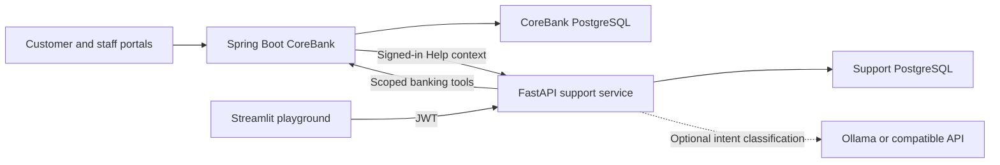

# CoreBank — Banking portal and AI-assisted support

CoreBank is a portfolio project that pairs a customer banking portal and staff
console with an authenticated support assistant. It uses synthetic customers
and transactions so you can try an end-to-end flow from a transfer or failed
withdrawal to a saved support case.

## What you can try

| Area | Features |
| --- | --- |
| Customer portal | Demo sign-in, account balances, internal transfers, withdrawals, transaction history, and CSV statements |
| Transfers | Masked recipient preview, review and confirmation, posted receipts, and retry recovery using the original transfer request |
| Customer Help | Questions about balances, history, and KYC, transaction selection from Activity, case drafts, explicit confirmation, and case tracking |
| Bank operations | Customer and account search, KYC updates, account credits, name corrections, account closure checks, and CSV exports |
| Standalone playground | Streamlit chat and a read-only view of support tickets, risk records, and audit activity |

Customers can clear the selected transaction in Help at any time. When a
transaction already has a support case, Help shows the existing case. Account
holder names are read-only in the customer portal. Staff can correct them
through the admin console.

## Run locally

Install Docker Desktop or Docker Engine with the Compose plugin. From a terminal:

```bash
git clone https://github.com/SsK-981/fintech-ai-agent-chatbot.git
cd fintech-ai-agent-chatbot
docker compose up --build
```

Compose starts both PostgreSQL databases, applies migrations, seeds synthetic
records, and starts the portal, support API, and playground. The default demo
runs without an API key or a local `.env` file. If sign-in fails while the
services are starting, check that the seeding service completed:

```bash
docker compose ps -a
docker compose logs corebank-seed
```

| Surface | URL |
| --- | --- |
| Customer portal | [localhost:8080](http://localhost:8080) |
| Bank operations | [localhost:8080/admin.html](http://localhost:8080/admin.html) |
| Streamlit playground | [localhost:8501](http://localhost:8501) |
| FastAPI reference | [localhost:8000/docs](http://localhost:8000/docs) |
| CoreBank API reference | [localhost:8080/swagger-ui.html](http://localhost:8080/swagger-ui.html) |

Use `docker compose down` to stop the stack while keeping the local database
volumes. The demo credentials below are for the synthetic local environment.

## Demo accounts and walkthrough

Select a customer on the sign-in page and click **Try demo account**. For
manual sign-in, the default password for these demo identities is `password123`.

| Identity | Email | Suggested walkthrough |
| --- | --- | --- |
| Amit Verma | `amit@example.com` | Failed withdrawal, case creation, and KYC status |
| Rahul Sharma | `rahul@example.com` | Receive an internal transfer and check the incoming transaction |
| Neha Patil | `neha@example.com` | Send an internal transfer and verify the receipt |
| Demo administrator | `demo.admin@corebank.local` | Review accounts, update KYC, and check staff controls |

1. Sign in as **Amit**, open **Activity**, and choose **Get help** on the failed withdrawal.
2. Ask “Why did this fail?” Help explains the recorded reason. Ask to open a
   case, review the issue summary, and confirm. Use **My cases** to view the saved case.
3. For an internal transfer, copy Rahul’s account number from his Overview or
   from the seeder logs. Sign in as Neha, enter the recipient and amount, verify
   the masked recipient preview, and confirm. Check the posted receipt in Activity.
4. Sign in to Bank operations to review the accounts and try a KYC update.

Account numbers and transaction references are generated for each database.
The signed-in Help demo supports the three seeded customers. See the
[full walkthrough](docs/DEMO.md) and [manual testing guide](docs/MANUAL_TESTING.md).

## Screenshots


## How it works



CoreBank owns accounts, identity and KYC, balances, and transaction records.
FastAPI owns conversations, case records, approved policy responses, and audit
events. The portal supplies the authenticated customer identity to Help.
Banking tools retrieve records scoped to that customer.

Transfers lock both accounts in account-ID order and post the debit and credit
together. The customer portal reuses its idempotency key after a timeout to
recover the original outcome. Support-case confirmation uses a transaction-linked
case record and a database uniqueness constraint to prevent duplicates.

See the [architecture notes](docs/ARCHITECTURE.md),
[Help rulebook](docs/HELP_RULEBOOK.md), and [threat model](docs/THREAT_MODEL.md).

## Optional local model

The default backend uses rules. Signed-in Help can use an optional model for
unfamiliar balance, transaction-history, or KYC questions. CoreBank validates
the suggested intent, retrieves records using the signed-in identity, and
writes the reply. The support workflow handles transaction selection and case
confirmation.

To try Ollama, pull the model and set the following values in a local `.env`.
These values target an Ollama instance running on the host with Docker Desktop.

```bash
ollama pull qwen3:4b-instruct
```

```dotenv
LLM_PROVIDER=ollama
LLM_MODEL=qwen3:4b-instruct
LLM_BASE_URL=http://host.docker.internal:11434/v1
```

Run `docker compose up -d backend` after changing the settings. When running
FastAPI directly on the same host as Ollama, use
`http://127.0.0.1:11434/v1`. See [.env.example](.env.example) for provider
settings. On Docker Engine without Docker Desktop, the endpoint must be
reachable from the backend container.

## Development and tests

The stack uses **Java 21, Spring Boot, Spring Security, JPA, and Flyway** for
banking, and **Python 3.12, FastAPI, SQLAlchemy, Alembic, and Streamlit** for
support. Docker Compose uses PostgreSQL for both services.

```bash
python3.12 -m venv .venv
source .venv/bin/activate
python -m pip install -r requirements-dev.lock
python -m pip install -e . --no-deps
python -m ruff check backend frontend tests scripts run_app.py
python -m ruff format --check backend frontend tests scripts run_app.py
python -m mypy backend
python -m pytest
(cd corebank && sh ./mvnw test)
```

On Windows, use `.venv\Scripts\Activate.ps1` and
`corebank\mvnw.cmd` from the appropriate directory. The Python suite skips
opt-in live integration tests by default. GitHub Actions runs the suites,
migration and image build checks, and chatbot-to-CoreBank integration checks.

| Path | Contents |
| --- | --- |
| `corebank/` | Banking API, customer portal, staff console, and Java tests |
| `backend/` | Help workflows, intent routing, banking tools, and case storage |
| `frontend/` | Standalone Streamlit playground |
| `alembic/` | Support database migrations |
| `tests/` | Python unit, API, and live integration tests |
| `docs/` | Demo, testing, architecture, and security documentation |
| `compose.yaml` | Local stack definition |

## Project scope

CoreBank models internal account transfers and simulated withdrawals with
synthetic data. Activity-risk labels come from rules. The project is intended
for local demonstration and does not connect to payment networks. See
[SECURITY.md](SECURITY.md) for the supported security boundaries.

Released under the [MIT License](LICENSE).
