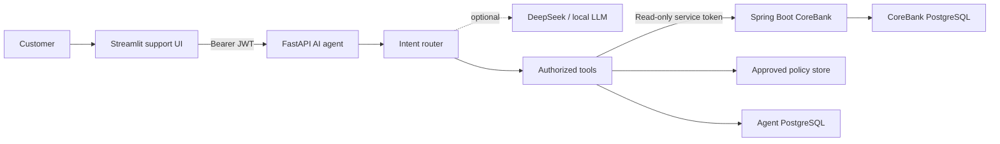

# AI Banking Support Platform


A grounded, multi-service fintech support system that connects a Spring Boot core
banking API to a FastAPI AI agent and a Streamlit customer interface.

The language model understands intent and can improve small-talk tone. It does not
invent balances, KYC states, transaction outcomes, refunds, or risk decisions. Those
facts come from authenticated CoreBank APIs and approved policy records.

## At a glance

| Area | Details |
|---|---|
| Problem solved | Safe AI support for banking questions that require live account facts |
| Main idea | LLM-assisted intent routing, deterministic financial answers, and strict service boundaries |
| Demo stack | Streamlit, FastAPI, Spring Boot, PostgreSQL, Docker Compose |
| Best proof points | Customer-scoped auth, failed-payment persistence, KYC admin workflow, explainable risk signals, CI |

## Why this project is different

- **Real service boundary:** the AI layer calls the Java banking API instead of reading
  its database.
- **Grounded answers:** tool-backed financial responses use deterministic templates;
  the LLM never rewrites them.
- **Object-level authorization:** customers cannot read another customer's records.
- **Banking data integrity:** decimal money, atomic transfers, optimistic locking, and
  persisted failed transaction attempts.
- **Explainable risk:** every risk level includes visible signals and a manual-review
  boundary.
- **Production-oriented operations:** PostgreSQL, Flyway and Alembic migrations,
  health checks, audit logs, Docker Compose, and cross-service CI.

## Architecture



Request flow and trust boundaries are documented in
[docs/ARCHITECTURE.md](docs/ARCHITECTURE.md).

## Screenshots

The support agent reads U002's live CoreBank history and reports posted and failed
transactions without letting the LLM alter banking facts.


The CoreBank landing page separates the customer portal from the protected operations
console.


Bank operations staff can review customers and update KYC status in the protected
CoreBank admin console.


## Project walkthrough

1. A customer signs in through the Streamlit support UI using a development JWT.
2. FastAPI validates the customer identity and routes the message through a local
   safety-first intent router.
3. Optional DeepSeek/OpenAI-compatible routing can improve conversational intent, but
   financial facts are always fetched through approved tools.
4. The AI service calls CoreBank with a separate read-only service token.
5. CoreBank independently checks account ownership before returning balances, KYC,
   transactions, failed attempts, or risk signals.
6. Deterministic response templates render banking facts so an LLM cannot change money,
   status, KYC, or risk decisions.
7. Conversations, source metadata, support tickets, audit events, and migrations are
   stored in the AI service database.

## Technology

| Layer | Stack |
|---|---|
| Banking system | Java 21, Spring Boot 4, Spring Security, JPA, Flyway |
| AI orchestration | Python 3.11+, FastAPI, Pydantic, SQLAlchemy |
| LLM support | DeepSeek/OpenAI-compatible API or local Ollama |
| User interface | Streamlit |
| Data | PostgreSQL in Compose; persistent H2/SQLite developer modes |
| Quality | Pytest, JUnit, Ruff, mypy, GitHub Actions |

## Repository layout

```text
.
├── corebank/                 Spring Boot banking system of record
├── backend/                  FastAPI agent, tools, security, persistence
├── frontend/                 Streamlit customer/admin experience
├── alembic/                  Agent database migrations
├── scripts/                  Deterministic CoreBank demo seeding
├── tests/                    Python API/unit/live integration tests
├── docs/                     Architecture, demo, and security notes
├── compose.yaml              Complete six-service local stack
└── run_app.py                One-click VS Code/local launcher
```

## Fastest start: Docker Compose

Requirements: Docker Desktop with Compose.

```bash
cp .env.example .env
docker compose up --build
```

On Windows PowerShell, use `Copy-Item .env.example .env` instead of `cp`.

Open:

- Customer chatbot: <http://127.0.0.1:8501>
- CoreBank portal: <http://127.0.0.1:8080>
- AI API docs: <http://127.0.0.1:8000/docs>
- CoreBank API docs: <http://127.0.0.1:8080/swagger-ui.html>

Compose starts two PostgreSQL databases, CoreBank, deterministic demo seeding, agent
migrations, FastAPI, and Streamlit.

## One-click VS Code start

Install Python 3.11+ and JDK 21+, then:

```powershell
python -m pip install -e ".[dev]"
Copy-Item .env.example .env
```

Set `BANKING_DATA_SOURCE=corebank` in `.env`. Open `run_app.py` and click the VS Code
Run button. The launcher discovers `JAVA_HOME` or an installed JDK, starts CoreBank,
seeds missing demo data, and starts the AI API and UI.

## Demo identities

The UI issues development-only customer tokens for `U001`, `U002`, and `U003`.
CoreBank seed data maps them to isolated banking customers.

Local admin portal credentials:

```text
Email:    demo.admin@corebank.local
Password: password123
```

These credentials and all Compose secrets are intentionally local-only. Replace them
before using any non-local environment.

## Demonstration scenarios

Select `U002` in the chatbot and try:

1. `What is my account balance?`
2. `Show my transactions.`
3. `Why did my failed withdrawal fail?`
4. `What is my KYC status?`
5. `Is my account risky?`
6. `Open a support case for the failed payment.`
7. Ask for another customer's information to demonstrate access denial.
8. Stop CoreBank and show that fallback is disabled in the integrated configuration.

See [docs/DEMO.md](docs/DEMO.md) for a complete 90-second interview script.
For publishing steps, repository topics, and profile copy, see
[docs/GITHUB_UPLOAD.md](docs/GITHUB_UPLOAD.md).

## LLM modes

The application runs without an external model using its deterministic router.

DeepSeek/OpenAI-compatible configuration:

```dotenv
LLM_PROVIDER=deepseek
LLM_MODEL=deepseek-v4-flash
LLM_API_KEY=your-key
LLM_BASE_URL=https://api.deepseek.com
LLM_POLISH_RESPONSES=true
```

Local Ollama configuration:

```dotenv
LLM_PROVIDER=ollama
LLM_MODEL=llama3.1
LLM_BASE_URL=http://127.0.0.1:11434/v1
```

Messages are redacted before provider routing. Provider failures and invalid structured
output fall back to local routing. Tool-backed financial answers bypass model polishing,
so the model cannot change an amount, status, KYC result, or risk score.

## Security model

- Customer-facing AI endpoints use scoped JWTs.
- CoreBank customer/admin pages use Spring Security.
- The AI-to-CoreBank adapter uses a separate read-only service credential, not customer
  passwords.
- CoreBank rechecks account ownership for every internal AI read.
- Production mode rejects disabled authentication and demo data seeding.
- Conversation access is owner-scoped and privileged actions are audited.

See [SECURITY.md](SECURITY.md) for supported reporting and remaining deployment work.

## Data integrity and risk controls

- Monetary values use `BigDecimal`/`Decimal` and fixed-scale database columns.
- Transfers update both accounts in one transaction.
- Optimistic locking prevents silent concurrent balance overwrites.
- Failed withdrawals/transfers are committed independently for support review.
- KYC lives in CoreBank and is updated through an admin-only endpoint.
- Risk rules are explainable and never auto-approve high-risk activity.

## Tests

```powershell
python -m pytest
python -m ruff check backend frontend tests scripts run_app.py
python -m ruff format --check backend frontend tests scripts run_app.py
python -m mypy backend

cd corebank
./mvnw test       # Windows: .\mvnw.cmd test
```

Current local verification:

- 60 Python unit/API tests
- 19 Spring Boot integration tests
- 1 live chatbot-to-CoreBank contract test
- Python backend coverage above 80%

GitHub Actions also validates both migration histories, builds all three container
targets, starts CoreBank, seeds it, and verifies chatbot answers against live Java data.

## Production configuration

The FastAPI service supports externally issued JWTs using issuer, audience, and JWKS
configuration. Both services support PostgreSQL and versioned migrations. Use managed
TLS, a secret manager, centralized rate limiting, monitoring, backups, and a real
identity provider before deployment.

This repository is a production-oriented portfolio system, not a licensed bank,
regulatory approval, or a validated fraud model. See
[docs/THREAT_MODEL.md](docs/THREAT_MODEL.md) for explicit limitations.

## Resume and GitHub profile copy

> Built a grounded AI banking support platform integrating Spring Boot and FastAPI via
> authenticated REST APIs; implemented customer-scoped authorization, persistent KYC
> and failed-payment records, concurrency-safe money movement, explainable risk rules,
> LLM fallback controls, database migrations, Docker Compose, and 80 automated
> cross-language tests.

Pinned repository description:

> Grounded AI banking support platform with a Spring Boot CoreBank API, FastAPI agent,
> Streamlit UI, PostgreSQL migrations, Docker Compose, and cross-service tests.

## License

MIT - see [LICENSE](LICENSE).
