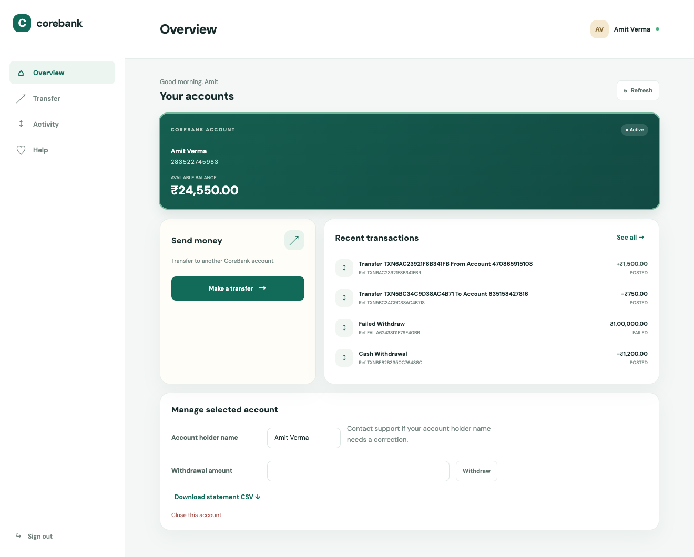
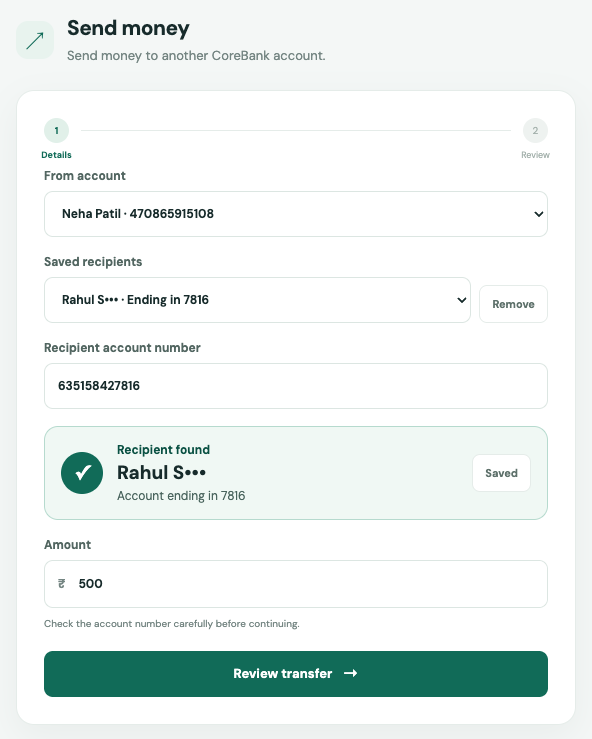
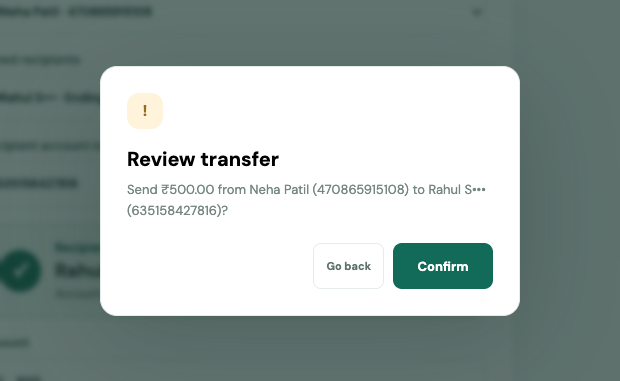
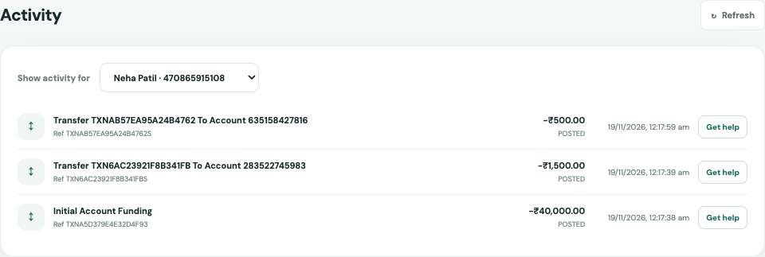
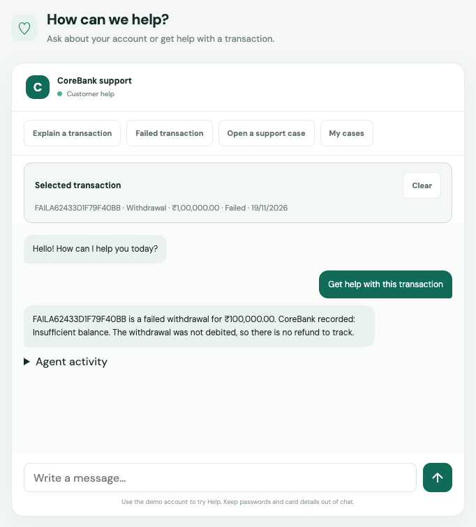
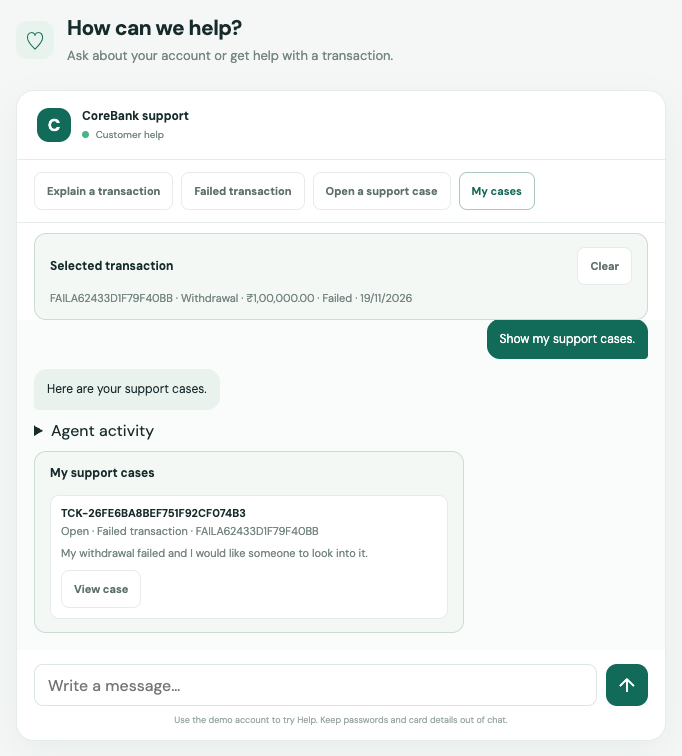
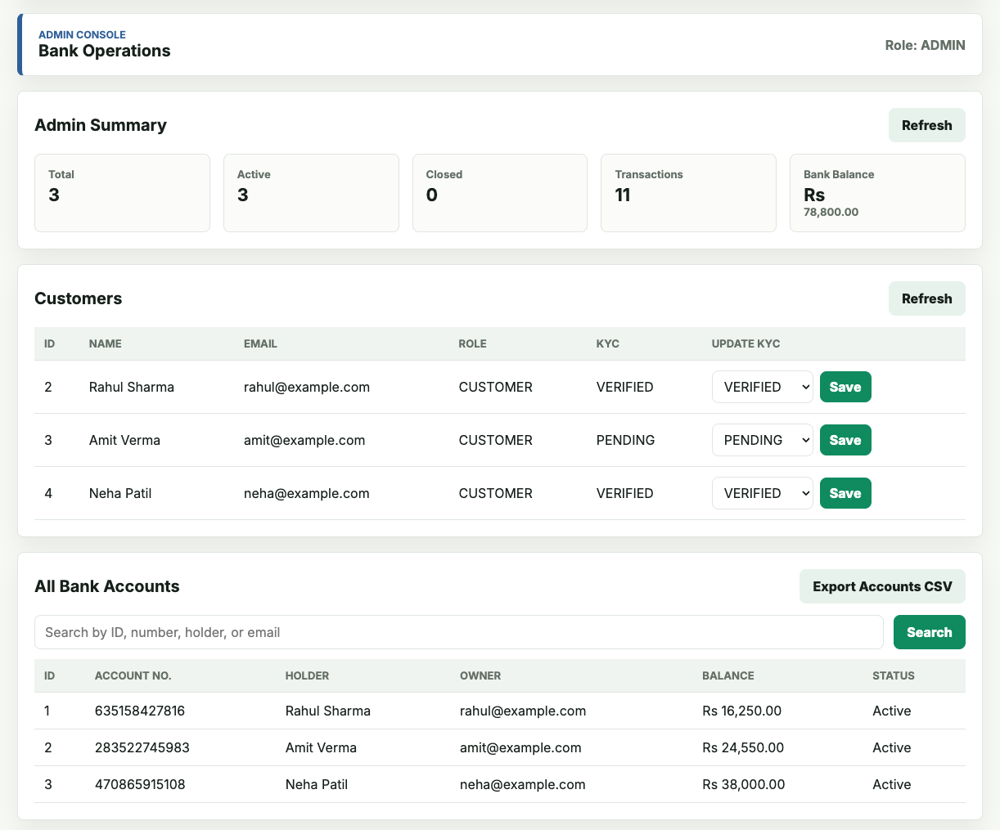
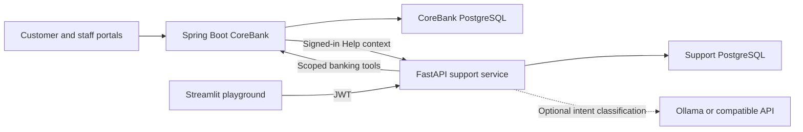

# CoreBank

CoreBank is a demo banking application with a customer portal, a staff console,
and a support assistant. Customers can manage accounts, send internal transfers,
and get help with a specific transaction. Staff can review accounts and update
identity verification (KYC) records. The demo runs locally with synthetic data.



[Run locally](#run-locally) · [Demo accounts](#demo-accounts) ·
[Architecture](#architecture) · [Development and tests](#development-and-tests)

## Features

| Surface | Capabilities |
| --- | --- |
| Customer portal | View balances and transaction history, withdraw demo funds, and download CSV statements. |
| Transfers | Verify the recipient’s masked name, save or remove recipients, review a transfer, and find both sides of the posted transaction in Activity. |
| Customer support | Open Help from a transaction to see its recorded status, review a support case before opening it, and track cases in chat. |
| Bank operations | Search accounts, update KYC, credit balances, correct account holder names, close eligible accounts, and export CSV records. |
| Support playground | Explore the assistant and view support tickets, activity-risk records, and audit events in Streamlit. |

## Product walkthrough

All screenshots were captured in a fresh local demo with synthetic accounts.

### Verify and save a recipient

Copy Rahul’s account number from his Overview, then sign in as Neha. In
**Transfer**, enter the number and verify the masked name. Select **Save
recipient** to add the account to your **Saved recipients** list. On a later
transfer, choosing that recipient fills in the account number and runs
verification again.



### Review and confirm a transfer

Enter ₹500 and select **Review transfer**. Check the sender, recipient, and
amount before confirming.



CoreBank displays a receipt reference once the transfer posts. The outgoing
entry in **Activity** appends `S` to that reference, and the incoming entry
appends `R`.



### Get help with a failed transaction

Sign in as Amit. In **Activity**, find the failed withdrawal and select
**Get help**. The assistant explains the recorded decline and whether the
account was debited. Use **Clear** to deselect the transaction.



Select **Open a support case**, describe the issue, and confirm the summary.
Open **My cases** to see the case status and select **View case** for details.
A failed transaction that already has a linked case shows the existing case.



### Review accounts in the staff console

Sign in as the demo administrator. The console shows account totals, customer
KYC statuses, and account search. From an account record, staff can manage the
balance, correct the account holder name, and export a statement.



## Run locally

Install Docker Desktop or Docker Engine with the Compose plugin. From a terminal:

```bash
git clone https://github.com/SsK-981/fintech-ai-agent-chatbot.git
cd fintech-ai-agent-chatbot
docker compose up --build
```

Compose starts both PostgreSQL databases, applies migrations, seeds synthetic
records, and starts the portal, support API, and playground. The default demo
runs without an API key or a local `.env` file. If sign-in fails while the
services are starting, check that the seeding service completed:

```bash
docker compose ps -a
docker compose logs corebank-seed
```

| Surface | URL |
| --- | --- |
| Customer portal | [localhost:8080](http://localhost:8080) |
| Bank operations | [localhost:8080/admin.html](http://localhost:8080/admin.html) |
| Streamlit playground | [localhost:8501](http://localhost:8501) |
| FastAPI reference | [localhost:8000/docs](http://localhost:8000/docs) |
| CoreBank API reference | [localhost:8080/swagger-ui.html](http://localhost:8080/swagger-ui.html) |

Use `docker compose down` to stop the stack while keeping the local database
volumes. The demo credentials below are for the synthetic local environment.

## Demo accounts

Select a customer on the sign-in page and click **Try demo account**. For
manual sign-in, the default password for these demo identities is `password123`.

| Identity | Email | Suggested walkthrough |
| --- | --- | --- |
| Amit Verma | `amit@example.com` | Failed withdrawal, case creation, and KYC status |
| Rahul Sharma | `rahul@example.com` | Receive an internal transfer and check the incoming transaction |
| Neha Patil | `neha@example.com` | Send an internal transfer and verify the receipt |
| Demo administrator | `demo.admin@corebank.local` | Review accounts, update KYC, and check staff controls |

Account numbers and transaction references are generated for each database.
The signed-in Help demo supports the three seeded customers. See the
[full walkthrough](docs/DEMO.md) and [manual testing guide](docs/MANUAL_TESTING.md).

## Example Help requests

| Ask Help | What happens |
| --- | --- |
| “Could you move ₹500 to Neha?” | Help offers **Go to Transfer**. You review and confirm the transfer there. |
| “Neha didn’t get the money I sent.” | Help offers recent transfers to check. |
| Select **Get help** on a failed withdrawal | Help explains the recorded reason and whether the amount was debited. |
| “They charged me twice.” | Help offers a support-case draft for you to review. |
| “What are my active cases?” | Help lists your open cases. |
| “Can I get a copy of my statement?” | Help points you to the CSV download. |
| Select **My cases**, then **View case** | Help displays the current status and details of the selected case. |

## Architecture



CoreBank owns accounts, identity and KYC, balances, and transaction records.
FastAPI owns conversations, case records, approved policy responses, and audit
events. The portal supplies the authenticated customer identity to Help.
Banking tools retrieve records scoped to that customer.

- **Transfer retries.** Transfers lock both accounts in account-ID order and
  post the debit and credit together. If the response is lost, the portal
  reuses its idempotency key to recover the saved outcome.
- **Saved recipients.** CoreBank stores each list under the customer’s
  signed-in identity. A database constraint prevents duplicate entries.
- **One case per linked transaction.** A database uniqueness constraint
  protects the transaction-to-case link when confirmation is repeated or sent
  from separate conversations.
- **Customer and staff permissions.** CoreBank authenticates the portal
  session. The support service checks its internal credential and uses
  customer-scoped tools. Staff-only changes, such as name corrections, are
  enforced by the server.

See the [architecture notes](docs/ARCHITECTURE.md),
[Help rulebook](docs/HELP_RULEBOOK.md), and [threat model](docs/THREAT_MODEL.md).

## Optional local model

The default backend uses rules. Signed-in Help can use an optional model for
unfamiliar balance, transaction-history, or KYC questions. CoreBank validates
the suggested intent, retrieves records using the signed-in identity, and
writes the reply. The support workflow handles transaction selection and case
confirmation.

To try Ollama, pull the model and set the following values in a local `.env`.
These values target an Ollama instance running on the host with Docker Desktop.

```bash
ollama pull qwen3:4b-instruct
```

```dotenv
LLM_PROVIDER=ollama
LLM_MODEL=qwen3:4b-instruct
LLM_BASE_URL=http://host.docker.internal:11434/v1
```

Run `docker compose up -d backend` after changing the settings. When running
FastAPI directly on the same host as Ollama, use
`http://127.0.0.1:11434/v1`. See [.env.example](.env.example) for provider
settings. On Docker Engine without Docker Desktop, the endpoint must be
reachable from the backend container.

## Development and tests

The stack uses **Java 21, Spring Boot, Spring Security, JPA, and Flyway** for
banking, and **Python 3.12, FastAPI, SQLAlchemy, Alembic, and Streamlit** for
support. Docker Compose uses PostgreSQL for both services.

```bash
python3.12 -m venv .venv
source .venv/bin/activate
python -m pip install -r requirements-dev.lock
python -m pip install -e . --no-deps
python -m ruff check backend frontend tests scripts run_app.py
python -m ruff format --check backend frontend tests scripts run_app.py
python -m mypy backend
python -m pytest
(cd corebank && sh ./mvnw test)
```

On Windows, activate the environment with `.venv\Scripts\Activate.ps1`. Change
into `corebank` before running `.\mvnw.cmd test`.

The Python suite runs unit and API tests by default. On a freshly seeded
disposable demo stack, enable the two live integration suites:

```bash
RUN_LIVE_COREBANK_TESTS=1 RUN_LIVE_PORTAL_HELP_TESTS=1 \
  COREBANK_BASE_URL=http://127.0.0.1:8080 \
  COREBANK_PORTAL_URL=http://127.0.0.1:8080 \
  python -m pytest tests/integration
```

These tests create synthetic failed transactions and support cases. GitHub
Actions also runs lint, type, migration, Java, and image build checks.

| Path | Contents |
| --- | --- |
| `corebank/` | Banking API, customer portal, staff console, and Java tests |
| `backend/` | Help workflows, intent routing, banking tools, and case storage |
| `frontend/` | Standalone Streamlit playground |
| `alembic/` | Support database migrations |
| `tests/` | Python unit, API, and live integration tests |
| `docs/` | Demo, testing, architecture, and security documentation |
| `compose.yaml` | Local stack definition |

## Project scope

CoreBank uses synthetic data and models internal account transfers and
simulated withdrawals. The portal does not connect to payment networks. Its
activity-risk labels come from rules and are intended for demonstration.
Integrated Help is mapped to the three seeded identities. The staff console
handles banking operations, and the Streamlit operations view can list support
cases without changing their status. See [SECURITY.md](SECURITY.md) for the
supported security boundaries.

Released under the [MIT License](LICENSE).
