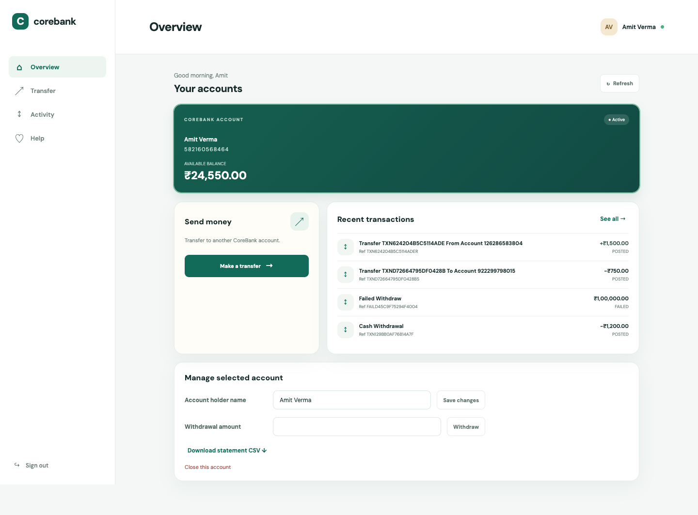
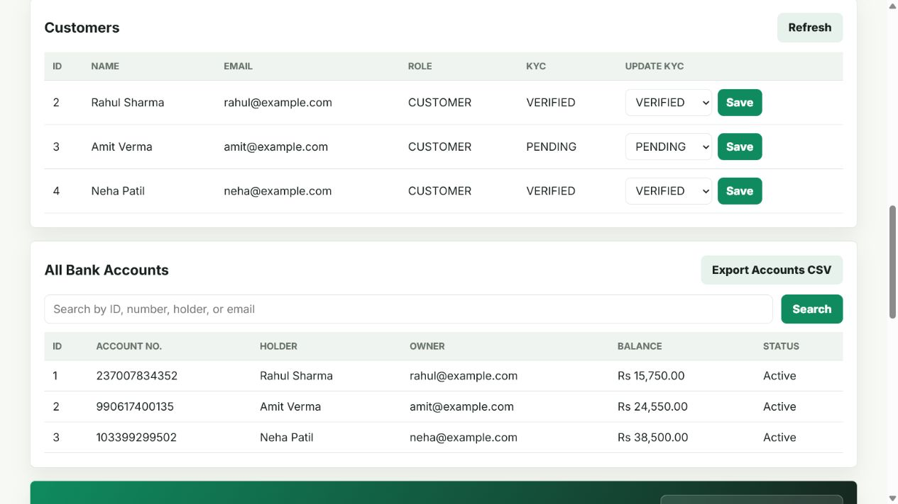
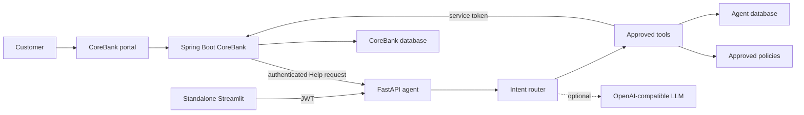

# AI Banking Support Platform

A grounded banking-support assistant that connects a Spring Boot CoreBank service with
a FastAPI agent, PostgreSQL-backed state, and deterministic banking tools. Customers
can manage accounts, transfer money, review activity, and open Help from one portal.

This is a production-oriented portfolio implementation using synthetic banking data.
The LLM can help classify and phrase requests, but it cannot directly read databases,
modify balances, or rewrite financial facts returned by CoreBank.

## Quick start

Install Docker Desktop (or Docker Engine with Compose), then run:

```bash
git clone https://github.com/SsK-981/fintech-ai-agent-chatbot.git
cd fintech-ai-agent-chatbot
docker compose up --build
```

1. Open [CoreBank](http://localhost:8080) and select **Try demo account**.
   The default local demo uses `amit@example.com` / `password123`.
2. Open **Activity** to see the seeded withdrawal and transfer history.
3. Open **Help** and ask “Show my transactions” or “What is my KYC status?”
   Help uses the same signed-in demo customer. New registrations can use the banking
   portal. Integrated Help currently supports the three seeded customers.
4. For a transfer demo, use Rahul’s account number from
   `docker compose logs corebank-seed`.

Compose starts the databases, applies migrations, seeds synthetic banking records,
and starts the support backend. The default demo works without an API key or a
`.env` file. If the portal opens before seeding finishes, wait for
`corebank-seed` to exit successfully and try again. Use `docker compose down`
to stop the stack and keep local demo data.

Other local surfaces:

- [Bank operations](http://localhost:8080/admin.html) with demo credentials
  `demo.admin@corebank.local` / `password123`
- [Standalone Streamlit playground](http://localhost:8501)
- [FastAPI docs](http://localhost:8000/docs) and
  [CoreBank API docs](http://localhost:8080/swagger-ui.html)

The seeded data, accounts, and defaults are intended for local development.
See [the manual testing guide](docs/MANUAL_TESTING.md) for the shared test accounts
and [the walkthrough](docs/DEMO.md) for a complete demo.

## Screenshots

The customer workspace brings accounts, transfers, activity, and Help together.



Operations staff can review customers, accounts, KYC state, and account activity
risk signals.



## Architecture



CoreBank is the system of record for customer identity, KYC, accounts, balances,
transactions, failed transaction attempts, and account activity risk. The agent owns
conversations, support tickets, approved policies, and audit events.

More detail: [docs/ARCHITECTURE.md](docs/ARCHITECTURE.md)

## Engineering guarantees

- **Grounded financial responses:** account facts are fetched through CoreBank tools
  and rendered with deterministic templates.
- **Customer-scoped access:** CoreBank authenticates the portal customer, FastAPI
  verifies the internal support request, and CoreBank rechecks account ownership.
  The standalone Streamlit client uses FastAPI JWT authentication.
- **Banking integrity controls:** money uses decimal types, transfers are transactional,
  failed attempts are persisted, and optimistic locking prevents silent balance loss.

## Tech stack

| Area | Stack |
|---|---|
| Core banking | Java 21, Spring Boot, Spring Security, JPA, Flyway |
| Agent API | Python 3.12, FastAPI, Pydantic, SQLAlchemy, Alembic |
| UI | CoreBank web portal, standalone Streamlit playground |
| Data | PostgreSQL in Docker Compose; local SQLite/H2 demo modes |
| Quality | Pytest, JUnit, Ruff, mypy, GitHub Actions |

## LLM modes

The application runs without an external model through its deterministic router.

OpenAI-compatible providers can be enabled for intent routing and tone:

```dotenv
LLM_PROVIDER=deepseek
LLM_MODEL=deepseek-v4-flash
LLM_API_KEY=your-key
LLM_BASE_URL=https://api.deepseek.com
LLM_POLISH_RESPONSES=true
```

Provider failures, invalid structured output, and malformed responses fall back to
local routing. Financial facts still bypass model polishing.

## Verification

Python checks:

```powershell
python -m ruff check backend frontend tests scripts run_app.py
python -m ruff format --check backend frontend tests scripts run_app.py
python -m mypy backend
python -m pytest
```

CoreBank checks:

```powershell
cd corebank
.\mvnw.cmd test
```

Current automated coverage in the repository:

- 60 Python unit/API tests
- 19 Spring Boot integration tests
- 1 live chatbot-to-CoreBank contract test
- Alembic and Flyway migration checks in CI
- Docker builds for backend, frontend, and CoreBank images

## Security boundaries

- Local demo credentials are only for synthetic data.
- Production mode rejects demo seeding and disabled authentication.
- The AI service uses a service credential, not customer banking passwords.
- Messages are redacted before optional LLM routing.
- Conversation access is owner-scoped and privileged actions are audited.
- A portfolio project is not a licensed bank, compliance program, or validated fraud
  model.

Security notes: [SECURITY.md](SECURITY.md)
Threat model: [docs/THREAT_MODEL.md](docs/THREAT_MODEL.md)

## Known limitations

- Demo identity selection still uses fixed local users.
- Account activity risk is rule-based and should not be described as fraud detection.
- PostgreSQL-backed concurrency tests should be expanded beyond the current local test
  coverage.
- Money movement still needs explicit idempotency keys and ledger-style postings before
  it can model retry-safe banking transfers.
- A reproducible agent evaluation dataset should be added for intent accuracy, tool
  selection, refusal behavior, and provider-failure recovery.

## Repository layout

```text
corebank/       Spring Boot banking system of record
backend/        FastAPI agent, tools, security, persistence
frontend/       Streamlit demo UI
alembic/        Agent database migrations
scripts/        CoreBank demo seeding
tests/          Python API, unit, and live integration tests
docs/           Architecture, demo, and threat-model notes
compose.yaml    Complete local stack
run_app.py      Local launcher for direct development
```

## License

MIT - see [LICENSE](LICENSE).
